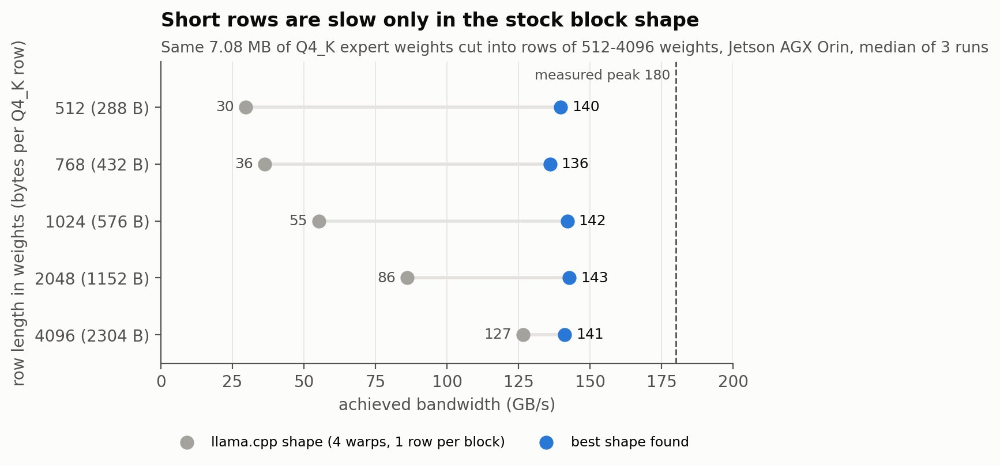
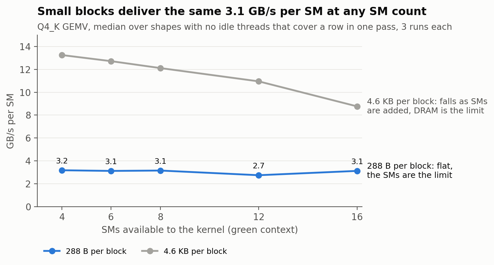
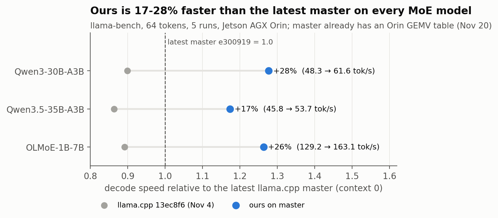

# Bytes per Block, Not Bandwidth
## Batch-1 MoE decoding on Jetson AGX Orin

Computing for Data Science 2 · Fall 2026

<!-- 0:00-0:20. One sentence: we made MoE decoding on Orin 42% faster by fixing how much work each thread block gets. -->

---

## The gap: 43 of 94 tokens/s

- Qwen3-30B-A3B (Q4_K_M) reads **1.92 GB per token**
- Orin reads **180 GB/s** (measured), so the ceiling is **94 tokens/s**
- llama.cpp decodes at **43.4 tokens/s**: 46% of the ceiling

Where do the other 54% go?

<!-- 0:20-0:50. Batch 1 means every token is matrix x vector over the active weights: bandwidth should be the limit. -->

---

## Profile against the transfer floor

| ms per token above the 10.7 ms floor | llama.cpp | ours |
|---|---:|---:|
| Quantized GEMV kernels | **10.3** | 2.7 |
| Small ops | 1.9 | 1.9 |
| Attention + host | 1.9 | 1.9 |

- Launches are already fused into CUDA graphs (1,110 kernels per token)
- Every GEMV reads exactly its weight bytes (Nsight Compute ratio 1.00), yet runs at about **50% of peak**

<!-- 0:50-1:35. The professor's advice: exclude transfer cost, find the real bottleneck. It is inside the GEMV kernels, not between them. -->

---

## Short rows are slow only in the stock block shape

Fine-grained experts have rows of 432 to 1,152 bytes. One row per block leaves too few bytes in flight.

<!-- 1:35-2:10. Same 7.08 MB of weights, only the row length changes. The best shape reaches 136-143 GB/s at every length. -->

---

## The SMs are the limit, not DRAM

Green contexts restrict a kernel to N SMs with clocks and DRAM unchanged. Small blocks: 3.1 GB/s per SM at any SM count.

<!-- 2:10-2:45. If DRAM were the limit, removing SMs would not cut throughput proportionally. Orin has few SMs for its bandwidth: about 9-10 bytes per SM per clock vs 3 on an RTX 4090. -->

---

## A block-shape rule from bytes and registers

1. **Warps:** 1 if a row needs at most 32 lanes, else 2
2. **Rows per block:** grow until the block reads **8 KB** (count gate and up when fused)
3. **At most 4 partial sums per thread**, counted by kernel template

Three iterations:
- v1 won on benchmarks, **lost 4-12% on real models**: the benchmark lacked the fused gate+up kernel
- v2: registers explained it (96 regs → 5 blocks per SM instead of 16)
- v3: registers follow the template, not the data → never slower

<!-- 2:45-3:45. The lesson matters as much as the rule: a microbenchmark must contain the kernel variants that dominate the real trace. -->

---

## Results: faster than the latest master too

- llama.cpp added an Orin GEMV table on Nov 20; we are still **+17% to +28%** faster on every MoE model (Qwen3-30B-A3B 48.3 → 61.6 tok/s, +42% vs where we started)
- Every format × row length is faster: fused gate+up median **1.64x**, plain 1.22x vs master
- Outputs unchanged: 5,411 tests pass, logits top-1 98.8%, perplexity within error

<!-- 3:45-4:30. Master's table puts 4 rows per block on the fused gate+up kernel: 96 registers, 5 blocks per SM. Our rule picks 2x2 there and fixes short rows, which master leaves alone. -->

---

## Takeaways

- The condition is **few SMs for the bandwidth**, not "edge"
- Choose block shape by **bytes per block and registers**, not by a list of formats
- Benchmarks must include **the kernel variants the real trace spends time in**
- RTX 3090: same kernel-level effect (short rows 28% → 74% of peak), but only +2-3% end to end: GEMV leaves 1.2 ms to recover in a 5 ms token, against 7.5 of 21 ms on Orin
- Open: 16-lane rows for 2-3 bit formats, the remaining small ops

<!-- 4:30-5:00 -->
